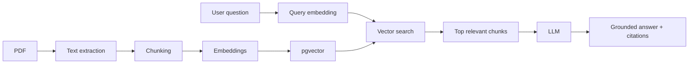

# Investment Knowledge Copilot

## Why this project exists

This project is a focused proof-of-concept that demonstrates an end-to-end **RAG (Retrieval-Augmented Generation)** pipeline over synthetic investment fund PDF documentation.

It is intentionally **not** a generic ChatGPT clone. The goal is to make every RAG step visible and explainable in an AI Engineer interview:

1. PDF text extraction (page-aware)
2. Chunking
3. Embeddings
4. Vector storage (PostgreSQL + pgvector)
5. Similarity retrieval
6. Grounded LLM generation
7. Citations + retrieval debug
8. Simple evaluation

There is **no LangChain** (or similar orchestration framework). Services call OpenAI and Supabase directly so the pipeline stays easy to walk through line by line.

---

## Architecture



| Layer | Choice |
| --- | --- |
| Frontend | React + TypeScript + Vite |
| Backend | Python + FastAPI + Pydantic |
| LLM / embeddings | Official OpenAI Python SDK |
| Database | Supabase PostgreSQL + pgvector |
| PDF parsing | PyMuPDF (`fitz`), page by page |

---

## Project layout

```
/
  frontend/          React UI (chat, sources, RAG debug, evaluation)
  backend/app/       FastAPI + RAG services
  supabase/migrations/  SQL schema + match_document_chunks RPC
  evals/             Fixed evaluation dataset
  sample_documents/  Synthetic Alpha / Beta PDFs
  .env.example
  README.md
```

Backend services map 1:1 to pipeline steps:

- `pdf_service.py` — validate + extract text per page
- `chunking_service.py` — token windows **within a page**
- `embedding_service.py` — batched OpenAI embeddings
- `document_service.py` — persist documents + chunks
- `retrieval_service.py` — query embedding + vector search (**no chat LLM**)
- `rag_service.py` — grounded prompt + generation + citations
- `evaluation_service.py` — keyword / source-hit checks

---

## RAG pipeline

### 1. Ingestion

`POST /api/documents/upload`

1. Validate PDF (extension, `%PDF` header, size limit)
2. Compute SHA-256 (skip re-ingest if already stored)
3. Open with PyMuPDF and extract text **per page**
4. Chunk each page independently (default 700 tokens, 120 overlap via `tiktoken`)
5. Batch-embed all chunks
6. Store content + metadata + `vector(768)` in Postgres (nomic-embed-text-v1.5)

Page boundaries are never crossed during chunking, so citation page numbers stay trustworthy.

### 2. Retrieval

For each user question:

1. Embed the question with the same embedding model
2. Call RPC `match_document_chunks` (cosine search via pgvector)
3. Keep top-K results above `RAG_SIMILARITY_THRESHOLD`
4. If the question explicitly names multiple fund display names, fetch a wider candidate set and balance slots so one document does not crowd out the other

**Retriever never calls the chat model.** That separation is deliberate for debugging.

### 3. Generation

`POST /api/chat`

1. Build a strict system prompt (answer only from provided context)
2. Format retrieved chunks as `[SOURCE n]` blocks with document, page, similarity, content
3. Ask the chat model for JSON: `{ information_found, answer, used_sources }`
4. Map `used_sources` back to stored chunk metadata for citations
5. Return answer + citations + retrieved chunks + latency metrics

### Cosine distance vs similarity

pgvector’s `<=>` operator returns **cosine distance** (0 = identical direction).

```
cosine similarity = 1 - cosine distance
```

The SQL RPC returns similarity so higher scores mean closer matches. The migration comments document this explicitly.

---

## Why chunking matters

Embedding models and context windows have limits. Chunking splits long PDFs into retrievable units:

- Small enough to stay topically focused
- Large enough to keep a fact with its surrounding sentence
- Overlap reduces the chance that a fee / ESG sentence is cut in half
- **Page-bounded** chunks preserve accurate page citations

---

## Why embeddings

An embedding turns text into a fixed-length numeric vector that captures semantic meaning. Similar sentences land near each other in vector space even when wording differs (“management fee” vs “annual management charge”).

This project uses an OpenAI-compatible embedding API (default: local LM Studio + **nomic-embed-text-v1.5**, dimension **768**, matching the DB column).

---

## Why vector search

Exact keyword search fails when users paraphrase. Vector search ranks chunks by semantic closeness to the question embedding, which is the core of RAG retrieval.

This PoC uses a single HNSW cosine index over `document_chunks.embedding` — simple, explainable, sufficient for a small corpus.

---

## Why citations

Citations force the UI (and the interviewer) to see **where** an answer came from:

- Document name from ingestion metadata
- Page number from PDF page extraction (never invented by the LLM)
- Short quote sliced from the stored chunk text

If retrieval returned the wrong page, the debug panel makes that obvious.

---

## Hallucination handling

Two layers:

1. **Empty retrieval** (no chunk above threshold) → skip the LLM and return exactly:
   `Informace nebyla v poskytnutých dokumentech nalezena.`
2. **Strict grounded prompt** → if context is insufficient, the model must set `information_found: false` and use the same Czech not-found sentence. It must not use general knowledge.

Evaluation **test 8** asks for the CEO of Northbridge Asset Management. That name is absent from the sample PDFs; the expected behaviour is “information not found”, not a fabricated person.

---

## Evaluation

Dataset: [`evals/dataset.json`](evals/dataset.json) (8 cases covering fees, ESG, comparison, and hallucination).

`POST /api/evaluation/run` runs each case through the real RAG path and measures:

- Document hit / page hit among retrieved chunks
- Expected keyword presence in the answer
- Top similarity and latency
- Hallucination PASS/FAIL for test 8

The Evaluation tab in the UI shows:

- Retrieval source accuracy
- Hallucination test
- Keyword accuracy
- Average latency

There is **no LLM-as-a-judge** in this MVP — checks stay deterministic and cheap to explain.

---

## Security considerations

- OpenAI API key and Supabase service role key exist **only on the backend**
- `.env` is gitignored; use `.env.example` as a template
- Upload validation: PDF only, size limit, binary header check
- CORS restricted to the local Vite origin (`http://localhost:5173` by default)
- Vector search goes through a parameterized Supabase RPC (no SQL string concatenation of user text)
- Sample documents are synthetic — no real personal or live investment data
- RLS enabled on tables; anon has no policies (backend uses service role)

---

## Known limitations

- Simple vector search only (no hybrid BM25, no cross-encoder reranker)
- No OCR — scanned / image-only PDFs will fail ingestion
- No enterprise identity / multi-tenant auth
- Chat history is client-side only
- Embedding dimension is fixed at 768 in the migration (nomic-embed-text-v1.5)
- Evaluation dataset is small and keyword-based
- Comparison questions rely on wider top-K + light document balancing, not agent planning

---

## Why I intentionally did not use an agent

This use-case is primarily **knowledge retrieval** over a fixed document set.

An agent (tool-calling loop, planners, multi-step autonomy) would add:

- Higher latency
- Higher cost
- Worse determinism
- A larger attack surface

A straightforward RAG pipeline is the better fit here and easier to defend in an interview.

If the product later required something like:

> “find fund facts, pull live numbers from an internal API, build a report, and email it”

then an agent / tool-calling design would become worth considering. That is an explicit future branch — not the architecture of this PoC.

---

## Production architecture on Azure

If this PoC were moved into an enterprise Azure environment, the architecture could map roughly as follows:

| PoC component | Possible Azure mapping |
| --- | --- |
| OpenAI API | Azure OpenAI |
| Supabase pgvector | Azure AI Search / suitable enterprise vector store |
| Local uploaded documents | Azure Blob Storage |
| Environment secrets | Azure Key Vault |
| Authentication | Microsoft Entra ID |
| Application telemetry | Application Insights / Azure Monitor |
| API / compute | Azure App Service / Container Apps / Functions depending on the use-case |

The concrete choice would depend on existing infrastructure, security requirements, cost, latency, and data volume.

---

## Getting started

### 1. Prerequisites

- Python 3.11+
- Node.js 20+
- A Supabase project with permission to run SQL
- An OpenAI API key

### 2. Configure environment

```bash
cp .env.example .env
```

Fill in:

```
OPENAI_API_KEY=lm-studio
OPENAI_BASE_URL=http://127.0.0.1:1234/v1
OPENAI_EMBEDDING_BASE_URL=http://127.0.0.1:1234/v1
OPENAI_CHAT_MODEL=qwen2.5-coder-7b-instruct-mlx
OPENAI_EMBEDDING_MODEL=text-embedding-nomic-embed-text-v1.5@q4_k_m
EMBEDDING_DIMENSIONS=768
SUPABASE_URL=https://YOUR_PROJECT.supabase.co
SUPABASE_SERVICE_ROLE_KEY=...
RAG_TOP_K=6
RAG_SIMILARITY_THRESHOLD=0.45
RAG_CHUNK_SIZE=700
RAG_CHUNK_OVERLAP=120
CORS_ORIGIN=http://localhost:5173
```

Model names are **never** hardcoded in services — only in config / env.

LM Studio must be running with the embedding model loaded (and a chat model for `/api/chat`). The backend talks to the OpenAI-compatible endpoint at `OPENAI_BASE_URL`.

### 3. Apply the database migration

In the Supabase SQL editor, run the full contents of:

[`supabase/migrations/001_init.sql`](supabase/migrations/001_init.sql)

This creates `documents`, `document_chunks`, the HNSW cosine index, and `match_document_chunks`.

### 4. Start the backend

```bash
python3 -m venv .venv
source .venv/bin/activate
pip install -r backend/requirements.txt

cd backend
uvicorn app.main:app --reload --host 127.0.0.1 --port 8000
```

Health check: `GET http://127.0.0.1:8000/api/health`

### 5. Start the frontend

```bash
cd frontend
npm install
npm run dev
```

Open `http://localhost:5173`. Vite proxies `/api` to the backend.

### 6. Upload sample documents

Use **Upload PDF** for:

- [`sample_documents/Alpha Growth Fund.pdf`](sample_documents/Alpha Growth Fund.pdf)
- [`sample_documents/Beta Income Fund.pdf`](sample_documents/Beta Income Fund.pdf)

Wait until embeddings finish (upload response includes `chunks_created`).

Regenerate PDFs if needed:

```bash
source .venv/bin/activate
python sample_documents/generate_pdfs.py
```

### 7. Ask questions

Examples:

- `What is the minimum initial investment for Alpha Growth Fund?`
- `Which fund has the lower annual management fee and by how much?`
- `Who is the CEO of Northbridge Asset Management?` → should return not found

Toggle **RAG Debug** to inspect retrieved chunks, similarities, and latencies.

### 8. Run evaluation

Open the **Evaluation** tab → **Run evaluation**, or:

```bash
curl -X POST http://127.0.0.1:8000/api/evaluation/run
```

---

## API overview

| Method | Path | Purpose |
| --- | --- | --- |
| GET | `/api/health` | Liveness |
| GET | `/api/documents` | List ingested documents |
| POST | `/api/documents/upload` | Ingest a PDF |
| POST | `/api/chat` | RAG Q&A |
| POST | `/api/evaluation/run` | Run eval dataset |

Example chat response shape:

```json
{
  "answer": "...",
  "citations": [
    {
      "document": "Alpha Growth Fund",
      "page": 2,
      "quote": "...",
      "similarity": 0.91
    }
  ],
  "retrieved_chunks": [],
  "metrics": {
    "retrieval_ms": 123,
    "generation_ms": 800,
    "total_ms": 923
  }
}
```
